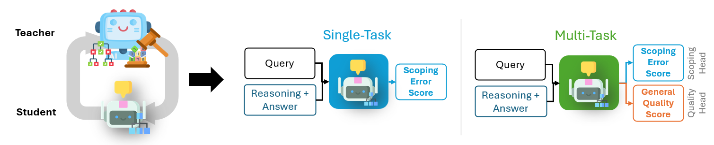

# Training Outcome Reward Models

This directory contains the code for distilling correctness and scoping error signals into outcome reward models.



## Repository Structure

```
training_code/
├── code/
│   ├── train.py                                     # Training code entrypoint and argument handler
│   ├── utils.py                                     # Basic utils for training
│   └── config[_scoping|_multitask|_multitask_uwso].toml  # Training config files where data/model/training parameters are controlled
├── data/
│   ├── train_[finqa|quantemp].csv                   # Training split
│   └── val_[finqa|quantemp].csv                     # Test split
├── README.md
└── requirements.txt
```

## Set-up Instructions

### Prerequisites

- CUDA-compatible GPU with at least 24 GB of RAM (training ORMs may require even more)
- System capable of running Python
- Clone of this repository

### 1. Clone this repository
```
git clone https://github.com/msmink01/numerical-scoping-errors.git
cd numerical-scoping-errors/code
```

### 2. Create a virtual environment for training and install dependencies
```
conda create -n scoping_training python=3.10.9
conda activate scoping_training
pip install torch==2.7.0 torchvision==0.22.0 torchaudio==2.7.0 --index-url https://download.pytorch.org/whl/cu128
pip install -r requirements.txt
```

## Usage

The following commands are all run from the `verifier/training_code/code` directory.

### Correctness ORM Training

Train basic correctness ORM for FinQA question-answering:
```
python train.py --config-file config.toml
```
_Note: if you instead want to train an ORM for QUANTEMP fact-checking, change the train_data, val_data and output_dir parameters in the config.toml file!_

Parameters:
- `config-file`: path to toml config file that specifies data, model details, training parameters, and output directory.

### Single-Task Scoping ORM Training

Train single-task scoping ORM for FinQA question-answering:
```
python train.py --type scoping --config-file config_scoping.toml
```
_Note: if you instead want to train an ORM for QUANTEMP fact-checking, change the train_data, val_data and output_dir parameters in the config_scoping.toml file!_

Parameters:
- `type`: which type of ORM to train
- `config-file`: path to toml config file that specifies data, model details, training parameters, and output directory.

### Multi-Task Scoping ORM Training

Train multi-task scoping ORM for FinQA question-answering:
```
python train.py --type multitask --config-file config_scoping.toml
```
_Note: if you instead want to train an ORM for QUANTEMP fact-checking, change the train_data, val_data and output_dir parameters in the config_multitask.toml file!_

Parameters:
- `type`: which type of ORM to train (change to `multitask-uwso` for UW-SO style training)
- `config-file`: path to toml config file that specifies data, model details, training parameters, and output directory.


## Output Format

Outputs are returned in the `model-output/[toml output_dir parameter]` folder. The folder contains: 

```
model_output/
├── [toml output_dir parameter]/
│   ├── checkpoint.pt                                # Final checkpoint without early stopping
│   ├── model_weights                                # Model weights with early stopping
│   ├── ... more model output files                  # Main engine for scoping error detection
│   └── train_verbose.json                           # Training statistics 
```

This output folder can then be used in the main README's verifier processing.

## References

1. [VerifierFC Paper](https://github.com/VenkteshV/VerifierFC)
2. [QUANTEMP Dataset](https://arxiv.org/abs/2403.17169)
3. [FinQA Dataset](https://arxiv.org/abs/2109.00122)

## License

Please see the main README for license information.